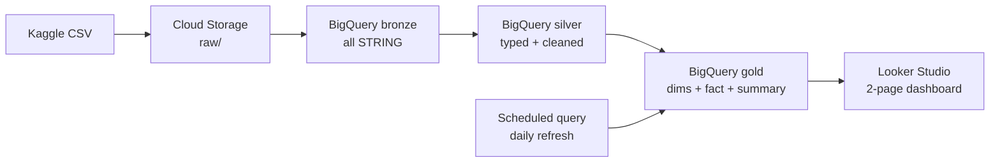
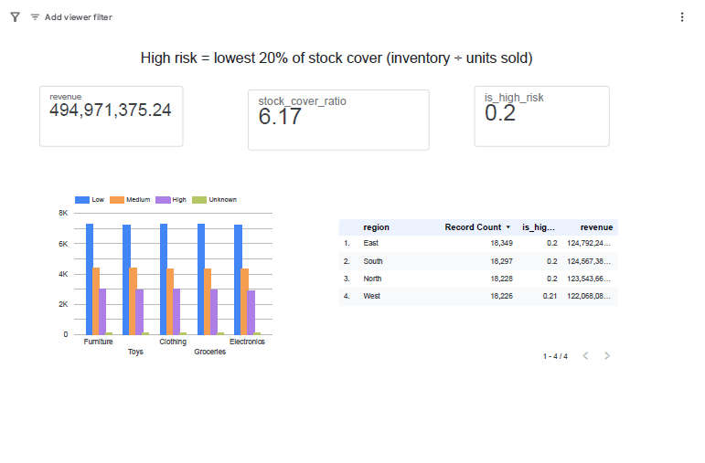
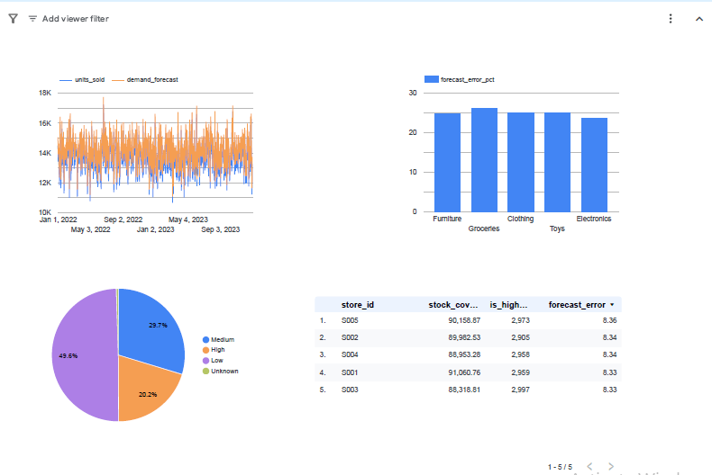

# Supply Chain Inventory Pipeline (GCP)

End-to-end batch data pipeline that turns raw retail inventory data into a stock-risk dashboard, built on Google Cloud.

## Architecture

## Dataset
Retail Store Inventory Forecasting Dataset (Kaggle), 73,100 rows: date, store, product, category, region, inventory level, units sold, units ordered, demand forecast, price, discount, promotions.

## Pipeline layers
| Layer | What happens |
|---|---|
| Bronze | CSV loaded as-is, all STRING (73,100 rows) |
| Silver | Types cast with SAFE_CAST, trimmed text, bad rows filtered, duplicates removed (73,100 rows kept) |
| Gold | dim_store, dim_product, dim_date, fact_inventory, stock_summary |

## Stock risk logic
- **stock_cover_ratio** = inventory_level / units_sold
- **stockout_risk** is percentile-based on the cover ratio: High = lowest 20%, Medium = next 30%, Low = top 50%, Unknown = units_sold is 0
- **stock_status**: Overstock when inventory is more than 2x units sold, otherwise Healthy
- **forecast_error** = |demand_forecast - units_sold|

Note: in this dataset inventory never falls below units sold, so "High" means the thinnest relative stock cover, not an actual stockout.

## Results
| Stockout risk | Share of records |
|---|---|
| Low | 49.57% |
| Medium | 29.70% |
| High | 20.24% |
| Unknown | 0.49% |

## Business Insights (Analyst View)
Period analysed: 2022-01-01 to 2024-01-01 (731 days), 5 categories, 4 regions. Queries are in the [Analysis/](Analysis/) folder.

> Note: this is a public synthetic benchmark dataset, so differences between segments are small. The analysis focuses on network-wide patterns.

**1. Stock risk is systemic, not segment-specific.** Across 20 category-region combinations, the high-risk share stays between 19.1% and 21.1%, median stock cover between 1.9 and 2.1 days of sales, and overstock (>2x sales) between 47.7% and 51.9%. *Recommendation:* review reorder policy network-wide rather than targeting one segment.

**2. Forecasts are accurate but biased high.** Forecast error (WAPE) is 6.1% to 6.2% in every category, and forecasts exceed actual sales by 3.6% to 3.7%. About 60% of the absolute error is net over-forecasting. *Recommendation:* recalibrate the forecast to remove the upward bias.

**3. Excess stock is modest but constant.** On an average day, about $387K of inventory sits above 2x daily sales, roughly 0.57 days of revenue. The 2x cutoff is a rule of thumb, and lead-time data would be needed to judge whether it is too high. *Recommendation:* track average daily excess value as a KPI and review safety stock targets.

**4. Discounts and promotions did not lift volume.** Average units sold stays near 136 per record at every discount level (0% to 20%) and with or without the holiday/promotion flag, while average revenue per record falls about 19.5% at 20% off. *Recommendation:* run a controlled test of shallower discounts. Margin data would be needed to confirm the profit impact.

**Limitations:** observational data (no causal claims), no cost or margin data, and a synthetic dataset.

## Automation
Scheduled query `refresh_gold_inventory` rebuilds all gold tables daily from silver.

## Dashboard
[Live dashboard] https://datastudio.google.com/reporting/958fe63f-1f01-4c2a-8fd0-d365a841534c

## Tech
GCP (Cloud Storage, BigQuery, scheduled queries), SQL, Looker Studio, medallion (bronze/silver/gold) modeling.

## How to run
See the `sql/` folder, in order from 01 to 07.
