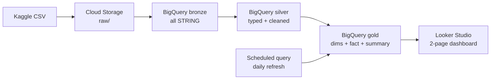

# Supply Chain Inventory Pipeline (GCP)

End-to-end batch data pipeline that turns raw retail inventory data into a stock-risk dashboard, built on Google Cloud.

## Architecture

## Dataset
Retail Store Inventory Forecasting Dataset (Kaggle), 73,100 rows: date, store, product, category, region, inventory level, units sold, units ordered, demand forecast, price, discount, promotions.

## Pipeline layers
| Layer | What happens |
|---|---|
| Bronze | CSV loaded as-is, all STRING (73,100 rows) |
| Silver | Types cast with SAFE_CAST, trimmed text, bad rows filtered, duplicates removed (73,100 rows kept) |
| Gold | dim_store, dim_product, dim_date, fact_inventory, stock_summary |

## Stock risk logic
- **stock_cover_ratio** = inventory_level / units_sold
- **stockout_risk** is percentile-based on the cover ratio: High = lowest 20%, Medium = next 30%, Low = top 50%, Unknown = units_sold is 0
- **stock_status**: Overstock when inventory is more than 2x units sold, otherwise Healthy
- **forecast_error** = |demand_forecast - units_sold|

Note: in this dataset inventory never falls below units sold, so "High" means the thinnest relative stock cover, not an actual stockout.

## Results
| Stockout risk | Share of records |
|---|---|
| Low | 49.57% |
| Medium | 29.70% |
| High | 20.24% |
| Unknown | 0.49% |

## Automation
Scheduled query `refresh_gold_inventory` rebuilds all gold tables daily from silver.

## Dashboard
[Live dashboard] https://datastudio.google.com/reporting/958fe63f-1f01-4c2a-8fd0-d365a841534c

## Tech
GCP (Cloud Storage, BigQuery, scheduled queries), SQL, Looker Studio, medallion (bronze/silver/gold) modeling.

## How to run
See the `sql/` folder, in order from 01 to 07.
